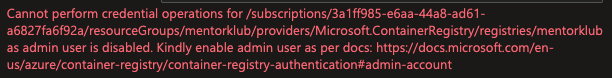

# NodeJS alapú webalkalmazás Azure-hoz

## Támogatott NodeJS verziók

- Node.js 24.22.1 vagy újabb

2026. október 21-én a Node.js projekt biztonsági kiadást adott ki. A legsúlyosabb hiba a beépített Brotli-dekóderben van ([CVE-2026-111497](https://nodejs.org/en/blog/vulnerability/october-2026-security-releases)): ha az alkalmazás a `node:zlib` modullal támadó által készített Brotli-adatot bont ki, a dekóder a belső pufferen túlírhat. Ez a folyamat összeomlásához, memóriatartalom kiszivárgásához vagy távoli kódvégrehajtáshoz vezethet. Ugyanez a kiadás további magas súlyosságú hibákat is javított, köztük a TLS-tanúsítvány hosztnév-ellenőrzésének megkerülését és a `dns.resolve()` NUL-bájtos névcsonkolását.

A 24-es LTS ágon ezek a javítások a **24.22.1**-es verzióban jelentek meg. Az ennél régebbi 24.x kiadások érintettek. A Node.js 20 már nem támogatott vonal, arra nem készült javítás. A 22-es ág javított kiadása a 22.23.4, a 26-osé a 26.12.1; ez a projekt a 24-es LTS vonalat követi, ezért a minimum a 24.22.1, és csak ennél újabb Node.js futtatható.

A Docker image a `node:24.22.2-slim` alapról épül. Ez a 24-es LTS aktuális kiadása, és tartalmazza a 24.22.1-ben javított hibákat.

Részletek: [Node.js security releases, 2026. október 21.](https://nodejs.org/en/blog/vulnerability/october-2026-security-releases)

## Kapcsolódó projekt

Nem Docker verzió: https://github.com/cloudsteak/trn-node-demo

## Helyi futtatás

Node.js 24.22.1 vagy újabb kell. Ellenőrizd a verziót:

```bash
node -v
```

A projekt mappájában telepítsd a függőségeket, majd indítsd az alkalmazást:

```bash
npm install
npm start
```

A szerver a [http://localhost:3000](http://localhost:3000) címen érhető el. Más portot a `PORT` környezeti változóval adhatsz meg:

```bash
PORT=8080 npm start
```

## Docker alapok

[docker-alapok.md](./docs/docker-alapok.md)

## Megoldás

A megoldás "Embedded JavaScript templating"-re épül. https://ejs.co

https://ejs.co/#install

## Teszt lépések

**[eslint](https://eslint.org/)** tesztelés előkészítve.
Ha CI pipeline-t telepítesz, akkor ellemőrzi a kódodban (példa alapján app.js) a pontosvesszők helyességét. A CD rész, csak akkor fut le, ha a CI (a teszt) sikeres.

Kézzel is futtatható a teszt:

```bash
npm run test
```

vagy

```bash
eslint ./app.js
```

## Azure Pipeline létrehozás és kapcsolat GitHub-al

1. Personal Acces Token létrehozás: https://github.com/settings/tokens
2. "Generate new token (classic)"
   - Note: A token neve. Adj valami értelmezhető nevet. Pl.: AZPIPELINEPAT
   - Expiration: Token lejárati ideje. Tesztelés esetén választhatod a "No expiration". Éles rendszer esetén adj lejárati időt!!!
   - Az alábbi részeket válaszd ki a jelölönégyzeteknél
     - "repo": mindegyiket alatta
     - "admin:repo_hook": mindegyiket alatta
     - "user": mindegyiket alatta
3. "Generate token" gombra kattintéssal a token létrejön.
4. A tokent másold biztonságos helyre! Nem visszafejthető.
5. Menj át az Azure DevOps-ba, a saját organization és project alapján. Pl.: https://cloudsteak.visualstudio.com/MentorKlub/_settings/adminservices (Project Settings > Service connections)
6. "Create service connection"
7. "New Azure service connection" résznél válaszd a GitHub-ot
8. "New GitHub service connection" résznél az alábbi módon töltsd ki
   - "Personal Access Token Authentication"
   - "Personal access token" mezőbe illeszd be a GitHub-on generált token értékét
   - "Service connection name" mezőbe adj egy nevet. Pl.: GITADOCONN
   - Jelöld be a "Grant access permission to all pipelines" jelölő négyzetet
   - Kattints a "Verify and Save" gombra
9. Menj a Pipeline részbe. Pl.: https://cloudsteak.visualstudio.com/MentorKlub/_build
10. "Create Pipeline"
11. GitHub (Yaml)
12. Select lapon görgess a lapaljára és kattints az utolsó sorban a linkre: "You may also select a specific connection."
13. Választd a "GITADOCONN"-t
14. Keresd meg a GitHub repo-k között, amivel kapcsolódni szeretnél.
15. Létező YAML esetén a Run gomb melletti nyilra kattins és válaszd a "Save" lehetőséget.
16. Várd meg míg a pipeline létrejön. Ezzel a kapcsolt kész.
17. Ha GitHub-on módosítasz a kódon, akkor a pipeline elindul és a benne lévő kód lefut.

## GitHub Actions: kép feltöltése ACR-be

A [`.github/workflows/build-push-pipeline.yml`](.github/workflows/build-push-pipeline.yml) a `main` és a `demo` ágra pusholáskor építi a Docker képet, és feltölti az Azure Container Registry-be. A workflow nem környezet (Environment) szintű értéket olvas, ezért a titkot és a változókat a **repó** szintjén kell felvenni.

Előtte az ACR-ben legyen bekapcsolva az admin felhasználó (`az acr update -n <acr-neve> --admin-enabled true`). Enélkül nincs felhasználónév és jelszó, amivel a pipeline be tud jelentkezni.

### Hol hozod létre

A repóban: **Settings → Secrets and variables → Actions**.

- A jelszó a **Secrets** fülre kerül, **New repository secret**.
- A másik két érték a **Variables** fülre kerül, **New repository variable**.

### Változók

| Név | Mit adj meg | Példa |
| --- | --- | --- |
| `ACR_LOGIN_URL` | Az ACR bejelentkezési címe, séma nélkül | `mentorklub.azurecr.io` |
| `ACR_USERNAME` | Az ACR admin felhasználóneve | `mentorklub` |

### Secret

| Név | Mit adj meg |
| --- | --- |
| `ACR_PASSWORD` | Az ACR admin jelszava. Ne kerüljön változóba, és ne kerüljön a repóba. |

### Értékek kiolvasása Azure-ból

A `<acr-neve>` az ACR erőforrás neve (a login URL eleje, a `.azurecr.io` nélkül).

```bash
# Bejelentkezési cím, pl. mentorklub.azurecr.io
az acr show --name <acr-neve> --query loginServer --output tsv

# Admin felhasználónév és jelszó
az acr credential show --name <acr-neve> --query "{username:username, password:passwords[0].value}" --output json
```

A `loginServer` értékét másold az `ACR_LOGIN_URL` változóba, a `username` mezőt az `ACR_USERNAME` változóba, a `password` mezőt az `ACR_PASSWORD` secretbe.

### Kép neve a workflow-ban

A kép neve (`ACR_IMAGE_NAME`) a workflow `env` blokkjában van, GitHub-változóként nem kell felvenni. Feltöltés előtt cseréld le a placeholderre a saját image nevedet a [`.github/workflows/build-push-pipeline.yml`](.github/workflows/build-push-pipeline.yml) fájlban:

```yaml
env:
  ACR_IMAGE_NAME: tanulo-xxxxxxxxx
```

A pipeline ezután két taggel tolja fel a képet: `latest`, és a commit rövid SHA-ja. A teljes cím: `<ACR_LOGIN_URL>/<ACR_IMAGE_NAME>:<tag>`.

## NodeJs alkalmazás Docker-izálása

Dockerfile: leírja az alkalmazás környezet kialakításának feltételeit és lépéseit.
.dockerignore: tartalmazza azon fájlok, mappák és minták lerását, amit a docker image készítő figyelmen kívül hagy.

### Helyi "Build and run"

Helyi gépen hogyan tesztelhetem.

#### 1. Image build

```bash
docker build --tag mentorklub.azurecr.io/trn-node-docker .
```

Megjegyzés: 
- Ha az image fájlt Apple Silicon processzoros gépen készítem, de utána Intel processzoros gépen használom, akkor a fenti parancshoz adjuk hozzá ezt: `--platform linux/amd64`
- Több platformos build: `docker buildx build --tag mentorklub.azurecr.io/trn-node-docker --push . --platform linux/amd64,linux/arm64,linux/arm/v7`
#### 2. Docker konténer létrehozás és futtatás

```bash
docker run -d -p 80:3000 --name nodedemo mentorklub.azurecr.io/trn-node-docker:latest
```

#### 3. Eredmény tesztelése

http://localhost

### Azure-ban futtatás

1. Azure Container Registry létrehozás

_Megjegyzés: Az ACR-nek Azure szinten egyedinek kell lennie. A lenti példában használt `mentorklub` ARC már létezik, így használj másikat, ha ezt is szeretnld kipróbálni._

```bash
# Erőforráscsoport létrehozás - ha szükséges
az group create --name mentorklub --location swedencentral

# ACR létrehozás
az acr create --resource-group mentorklub --name mentorklub --sku Basic

# Admin engedlyezése
az acr update -n mentorklub --admin-enabled true
```

2. Pipeline építés Azure DevOps-ban
  
3. Pipeline azure-pipelines.yml fájl módosítás

Hogy csak a Push esetén fusson le. Illesszük be a `condition: eq(variables['Build.reason'], 'IndividualCI')` sort.

```yaml
stages:
  - stage: Build
    displayName: Build and push stage
    condition: eq(variables['Build.reason'], 'IndividualCI')
    jobs:
```

A tag-ekhez tegyük be a `latest` értéket is.

```yaml
containerRegistry: $(dockerRegistryServiceConnection)
tags: |
  $(tag)
  latest
```

4. Webalkalmazás létrehozása (Docker)

5. Webalkalmazás módosítása

   1. Üzembehelyezési központban állítsuk át a `Folyamatos telepítés` értékés `Bekalcsolva`-ra.
   2. Konfiguráció > Általános beállítások > Mindig bekapcsolva: Be


## AKS

AKS-en való futtatáshoz itt találsz leírást: [aks/readme.md](aks/readme.md)


## Hibakezelés

1. Admin Account engedélyezése az ACR-ben

Ha frissen hoztunk létre egy Azure Container Registry-t, akkor az alapértelmezett beállítások miatt nem tudunk hozzáférni az ACR-hez. 

Amikor megpróbálunk mégis hozzáférni webalkalmazásból, akkor a következő hibát kapjuk:



Hiba megoldása, hogy engedélyezzük az Admin Account-ot az ACR-ben.

1. Jelentkezzünk be az ACR-be:

```bash
az acr login --name mentorklub

```

2. Engedélyezzük az Admin Account-ot:

```bash
az acr update -n mentorklub --admin-enabled true
```
